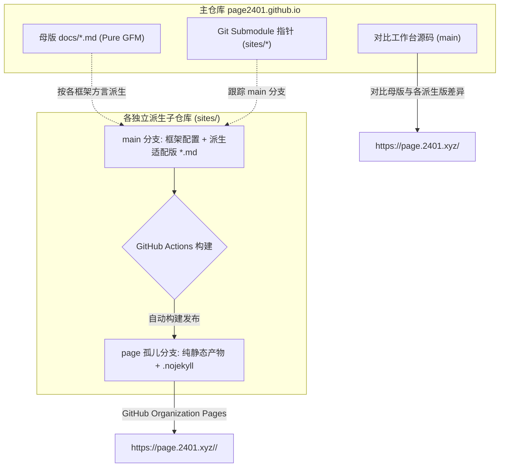
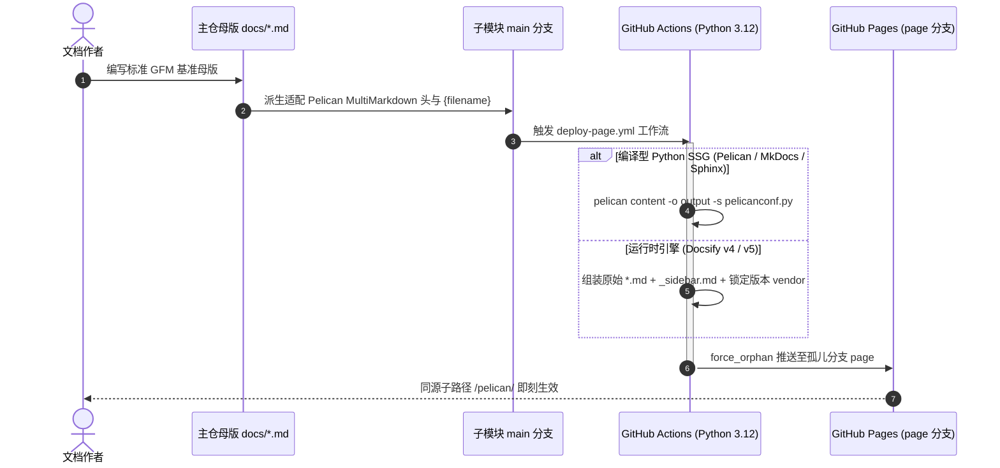
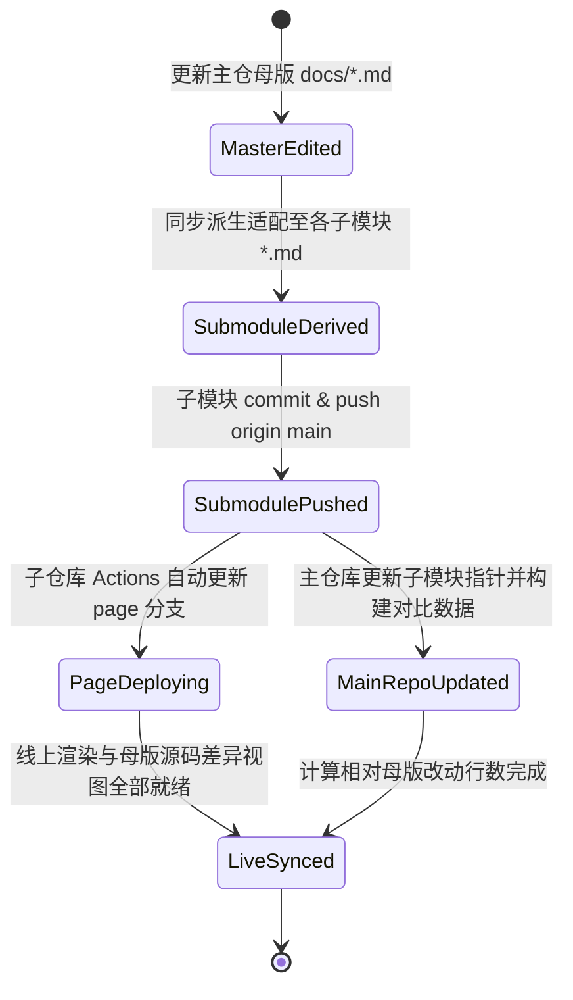

Title: 02. 流程图与时序图
Description: Pelican 4.12.0 实测：通过 pelicanconf.py 挂载 pymdownx.superfences 自定义 mermaid 围栏与本地 mermaid@12.3.0。
Order: 02
Slug: 02-diagrams
URL: 02-diagrams/
Save_as: 02-diagrams/index.html

# 02. 流程图与时序图（Pelican + `superfences` + 本地 Mermaid `12.3.0`）

相比采用 YAML 配置文件、不得不书写 `!!python/name:pymdownx.superfences.fence_code_format` 特殊反序列化标签的 MkDocs，Pelican 的配置文件 `pelicanconf.py` **本身就是标准 Python 模块**——可直接 `from pymdownx.superfences import fence_code_format` 传入可调用对象，将母版 ```` ```mermaid ```` 围栏一字不改编译为 `<pre class="mermaid"><code>...</code></pre>`，再由 `theme/static/vendor/mermaid.min.js` 在本地渲染并随深浅色主题切换重绘。

## 1. 复杂子图与架构流程图（`flowchart TD`）

测试中文节点标签、子图嵌套（`subgraph`）、尖括号 `<id>` 转义安全与虚线边：



## 2. 编译管线交互时序图（`sequenceDiagram`）

测试多参与者生命线、`alt` 分支块及激活框（`activate`/`deactivate`）：



## 3. 子模块同步状态机（`stateDiagram-v2`）

测试状态机语法与状态迁移说明标签：


